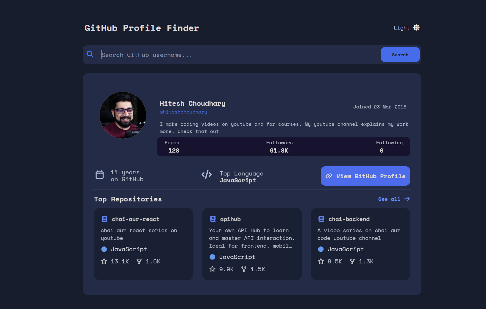
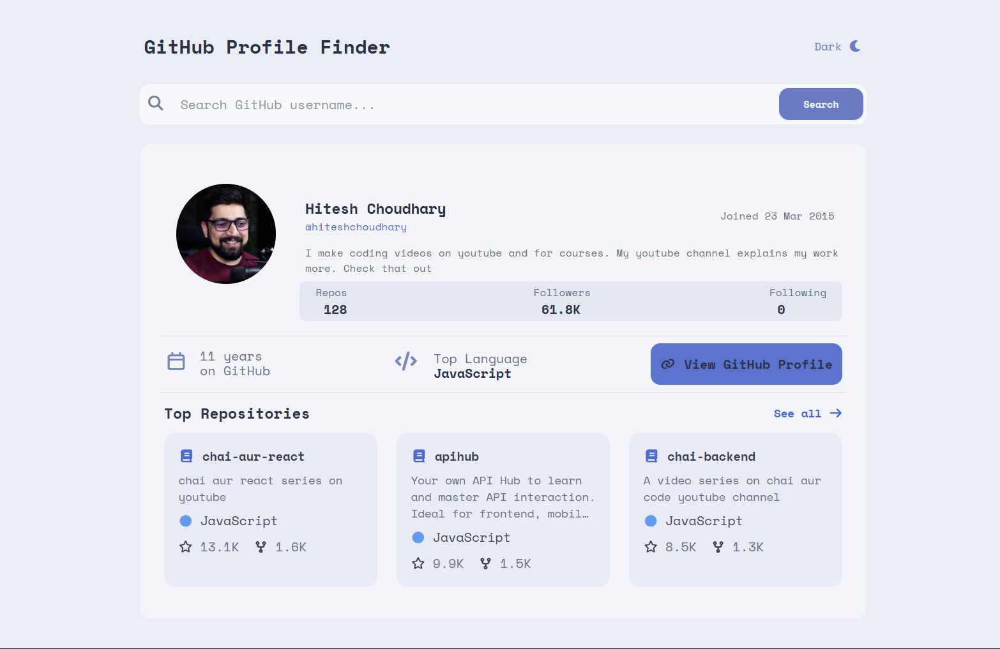

# GitHub Profile Finder

A simple and interactive web application that lets you explore GitHub profiles by entering a username. View profile information, GitHub statistics, and top repositories in one place.

## Screenshots

### Dark Theme


### Light Theme


## Features

- **GitHub Profile Search:** Search for any GitHub user by username.
- **Profile Information:** View the user's avatar, name, username, bio, and account creation date.
- **GitHub Statistics:** Display public repositories, followers, and following.
- **Account Age:** Calculate how long the user has been on GitHub.
- **Top Programming Language:** Identify the most frequently used programming language across the user's repositories.
- **Top Repositories:** Display the top three repositories, sorted by star count.
- **Repository Details:** View repository descriptions, programming languages, stars, and forks.
- **Dark & Light Themes:** Switch between dark and light modes.
- **User-Friendly States:** Dedicated welcome, loading, invalid username, and repository error screens.

## Tech Stack

- HTML5
- CSS3
- JavaScript (Vanilla JS)
- GitHub REST API

## Getting Started

### 1. Clone the repository

```bash
git clone https://github.com/vishal-kumar-swe/github-profile-finder
```

### 2. Navigate to the project directory

```bash
cd GitHub-Profile-Finder
```

### 3. Run the project

Open `index.html` in your browser.

Alternatively, use the Live Server extension in VS Code for a local development server.

## How to Use

1. Open the application.
2. Enter a GitHub username in the search bar.
3. Click **Search**.
4. Explore the user's profile information and statistics.
5. Browse their top repositories.
6. Switch between dark and light themes using the theme control.

## API

This project uses the [GitHub REST API](https://docs.github.com/en/rest) to retrieve public user and repository information.

## What I Learned

Through this project, I practised:

- Fetching data from REST APIs using the Fetch API.
- Working with JSON responses.
- Handling asynchronous operations and API errors.
- DOM manipulation and dynamic UI updates.
- Array methods and sorting algorithms.
- Managing different UI states.
- Using CSS custom properties for theme management.
- Organizing JavaScript and CSS into separate files.

## Future Improvements

- Save the user's preferred theme using Local Storage.
- Improve responsive design for smaller screens.
- Add more profile and repository information.

---

**Built as a hands-on project to strengthen my JavaScript and frontend development skills.**